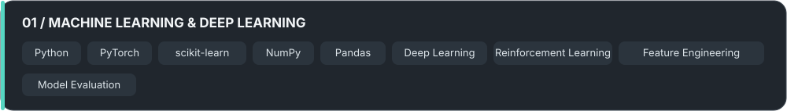
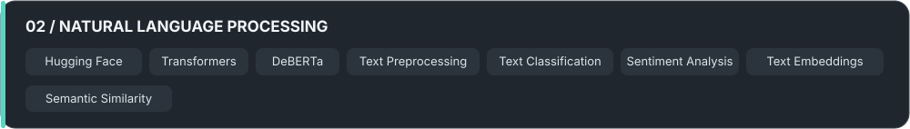
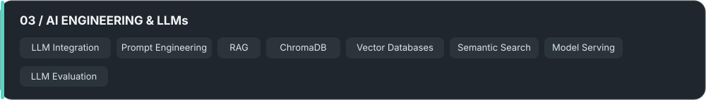
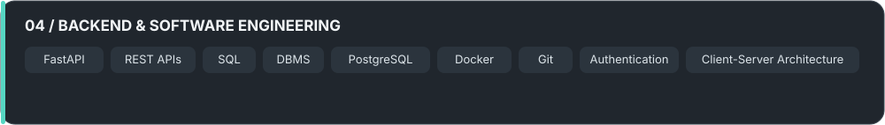

[Email](mailto:srivarma153@gmail.com) · [GitHub](https://github.com/SrivarmaBattini) · [LinkedIn](https://www.linkedin.com/in/srivarma-battini-20b37632b/)

## About

I build intelligent applications that bring together model development, language understanding, and software systems. I enjoy exploring technical ideas, evaluating different approaches, and turning experiments into practical tools.

*Learn continuously. Build thoughtfully. Innovate with purpose.*

## Technical Skills

## Selected Projects

<table>
<tr>
<td width="50%" valign="top">

### [EmailIQ ↗](https://github.com/SrivarmaBattini/EmailIQ)

An email intelligence tool that examines tone, intent, urgency, politeness, sarcasm, and passive aggression. It combines custom DeBERTa models with retrieval-assisted rewriting to help users refine messages with conversational context in mind.

**Stack:** Python, DeBERTa, FAISS, Groq, FastAPI, Supabase

</td>
<td width="50%" valign="top">

### [ML Recall ↗](https://github.com/SrivarmaBattini/MLRecall)

An adaptive memory-review scheduling project that models retention as a Restless Multi-Armed Bandit problem. Its QWI approach combines Q-learning, Whittle Index prioritization, and memory-decay modeling to study review policies under limited resources.

**Stack:** Python, Reinforcement Learning, RMAB, Optimization, FastAPI

</td>
</tr>
<tr>
<td width="50%" valign="top">

### [Auto Aim Laser Turret ↗](https://github.com/SrivarmaBattini/Auto-Aim-Laser-Turret)

A computer-vision and robotics project that tracks targets from a live camera feed, estimates movement angles, and translates them into servo commands through a ROS 2 and Raspberry Pi setup.

**Stack:** Python, OpenCV, ROS 2, Raspberry Pi, Servo Control

</td>
<td width="50%" valign="top">

### [InferenceHub ↗](https://github.com/SrivarmaBattini/InferenceHub)

A backend service for managing machine-learning inference workloads. The project includes API routing, database migrations, structured logging, request tracing, caching, and streaming-oriented components.

**Stack:** Python, FastAPI, Docker, Gunicorn, Alembic

</td>
</tr>
</table>

## Resume

[**Download Resume ↓**](assets/Srivarma_Battini_Resume.pdf)

*Place the PDF at `assets/Srivarma_Battini_Resume.pdf` to activate the link.*

---

[Email](mailto:srivarma153@gmail.com) · [GitHub](https://github.com/SrivarmaBattini) · [LinkedIn](https://www.linkedin.com/in/srivarma-battini-20b37632b/)

