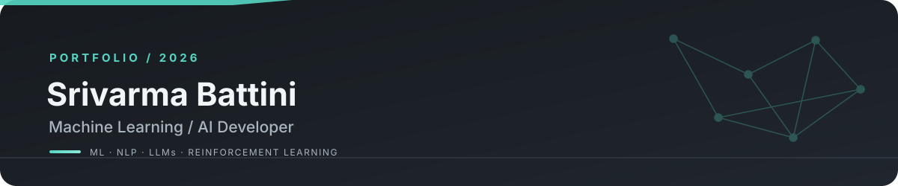

<table>
<tr>
<td align="center">

</td>
<td align="center">

</td>
<td align="center">

</td>
<td align="center">

</td>
</tr>
</table>

---

## About Me

I'm a Machine Learning / AI Developer interested in understanding how intelligent systems learn from data, process information, and solve real-world problems. My interests span **Machine Learning, Deep Learning, Natural Language Processing, Large Language Models (LLMs), Reinforcement Learning, and AI Engineering**.

I'm particularly interested in exploring how language models understand and generate text, how Retrieval-Augmented Generation (RAG) enhances LLM applications, and how machine learning models can be integrated into reliable, practical software systems. I also enjoy experimenting with learning algorithms, exploring model architectures, and understanding the reasoning behind different technical approaches.

My goal is to strengthen my foundations in AI while building useful applications that combine intelligent models, thoughtful system design, and effective engineering.

---

## Technical Skills

### Programming & Data

### Machine Learning

### AI Engineering

### NLP & Language Models

### Backend & Infrastructure

---

## Featured Projects

<table>
<tr>
<td width="50%" valign="top">

**01 · LANGUAGE INTELLIGENCE**

### [EmailIQ ↗](https://github.com/SrivarmaBattini/EmailIQ)

An AI-powered email analysis and rewriting system that examines **tone, intent, urgency, politeness, sarcasm, and passive aggression**, including changes in tone across a conversation.

Custom DeBERTa-v3-small models analyze messages, while retrieval-assisted LLM rewriting helps produce more context-aware communication.

**Highlights**
- Multi-signal email analysis
- Context-aware rewriting with RAG
- API and database integration

`DeBERTa` `FAISS` `Groq` `FastAPI` `Supabase`

</td>
<td width="50%" valign="top">

**02 · REINFORCEMENT LEARNING**

### [ML Recall ↗](https://github.com/SrivarmaBattini/MLRecall)

A memory-retention scheduling project that frames review decisions as a **Restless Multi-Armed Bandit (RMAB)** problem.

Its QWI approach uses Q-learning and Whittle Index prioritization to investigate how review opportunities can be allocated under a limited daily review budget.

**Highlights**
- Review prioritization
- Memory-decay modeling
- Simulation and policy evaluation

`Python` `QWI` `Q-Learning` `RMAB` `Whittle Index`

</td>
</tr>
<tr>
<td width="50%" valign="top">

**03 · COMPUTER VISION & ROBOTICS**

### [Auto Aim Laser Turret ↗](https://github.com/SrivarmaBattini/Auto-Aim-Laser-Turret)

A vision-guided pan-tilt system that detects and tracks targets in a live camera feed, estimates movement angles, and translates them into servo commands.

It connects **OpenCV, ROS 2, and Raspberry Pi hardware** to bridge visual perception and physical actuation.

**Highlights**
- Live target detection and tracking
- Geometric angle estimation
- Servo control through hardware interfaces

`OpenCV` `ROS 2` `Raspberry Pi` `Python` `PWM/GPIO`

</td>
<td width="50%" valign="top">

**04 · ML SYSTEMS & BACKEND**

### [InferenceHub ↗](https://github.com/SrivarmaBattini/InferenceHub)

A machine-learning systems project focused on model inference and backend infrastructure. Update this description to match the actual features and architecture implemented in the repository.

**Highlights**
- Add verified implementation highlights
- Describe actual system design decisions
- Include performance results only if measured

`Python` `FastAPI` `Docker`

</td>
</tr>
</table>

---

[Email](mailto:srivarma153@gmail.com) · [GitHub](https://github.com/SrivarmaBattini) · [LinkedIn](https://www.linkedin.com/in/srivarma-battini-20b37632b/)

