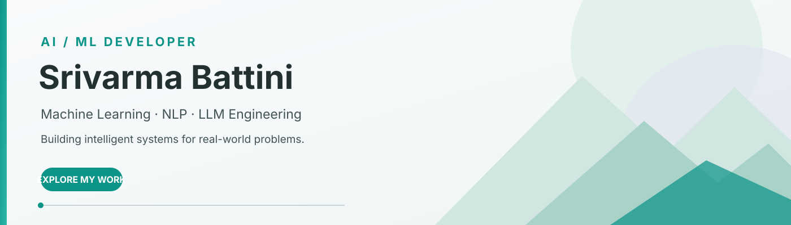
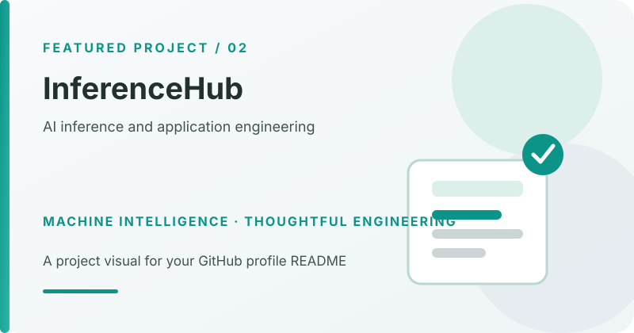
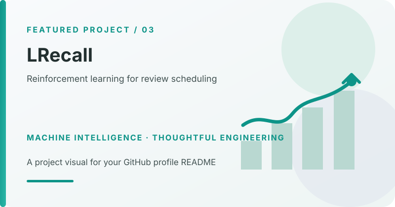

  
  
  

**AI/ML Developer | NLP | LLM Engineering**

*Turning machine learning ideas into practical, thoughtfully engineered applications.*

---

## About

I'm **Srivarma Battini**, an AI/ML developer interested in how intelligent systems learn, understand language, and solve real-world problems. I work across **Machine Learning, Natural Language Processing, LLM-powered applications, and backend development**, with additional project experience in reinforcement learning and robotics.

I enjoy taking a problem from concept to implementation: understanding the fundamentals, designing the pipeline, evaluating the approach, and building an application around it.

## Featured Projects

<table>
<tr>
<td width="50%" valign="top">

<h3>01 · EmailIQ</h3>

**NLP · Email Intelligence**

Analyzes workplace email signals and helps generate more professional rewrites while preserving the writer's original intent.

`DeBERTa` `SBERT` `RAG` `ChromaDB` `LLMs`

**[View repository](https://github.com/SrivarmaBattini/EmailIQ)**

</td>
<td width="50%" valign="top">

<h3>02 · InferenceHub</h3>

**AI Engineering · Model Inference**

An AI engineering project focused on making model inference and intelligent capabilities usable through an application workflow.

`AI Engineering` `Model Inference` `Backend`

**[View repository](https://github.com/SrivarmaBattini/InferenceHub)**

</td>
</tr>
<tr>
<td width="50%" valign="top">

<h3>03 · MLRecall</h3>

**Reinforcement Learning · Adaptive Review**

Explores how to allocate a limited daily review budget to improve long-term memory retention through spaced repetition.

`Python` `Whittle Index` `RL` `FastAPI`

**[View repository](https://github.com/SrivarmaBattini/MLRecall)**

</td>
<td width="50%" valign="top">

<h3>04 · Auto Aim Laser Turret</h3>

**Visual Perception · Robotic Control**

A ROS-based target-tracking project combining visual processing, robotic communication, and servo control.

`ROS 2` `Python` `OpenCV` `Computer Vision`

**[View repository](https://github.com/SrivarmaBattini/Auto-Aim-Laser-Turret)**

</td>
</tr>
</table>

## Technical Toolkit

| Focus | Technologies and concepts |
|---|---|
| **Machine Learning** | Python, PyTorch, scikit-learn, NumPy, Pandas, neural networks, deep learning, reinforcement learning, feature engineering, model evaluation |
| **Natural Language Processing** | Hugging Face, Transformers, text classification, sentiment analysis, text embeddings, semantic similarity, text preprocessing |
| **Backend Development** | FastAPI, REST APIs, SQL, PostgreSQL, Docker, Git, DBMS, authentication, client-server architecture |
| **AI Engineering** | LLM integration, prompt engineering, retrieval-augmented generation (RAG), ChromaDB, vector databases, semantic search, model serving |

## What I'm Exploring

- Building practical applications around language models and retrieval systems.
- Reinforcement learning and decision-making under resource constraints.
- Reliable model evaluation and the path from experimentation to deployment.

  Learn continuously · Build thoughtfully · Innovate with purpose

<!--
SETUP CHECKLIST
1. Replace PROJECT_REPO_URL_EMAILIQ with the actual EmailIQ repository URL.
2. Replace PROJECT_REPO_URL_INFERENCEHUB with the actual InferenceHub repository URL.
3. Replace PROJECT_REPO_URL_LRECALL with the actual LRecall repository URL.
4. Replace PROJECT_REPO_URL_ROBOTICS with the actual Computer Vision & Robotics repository URL.
5. Keep the assets/ directory alongside this README.md.
6. Preview on GitHub before committing.
-->
